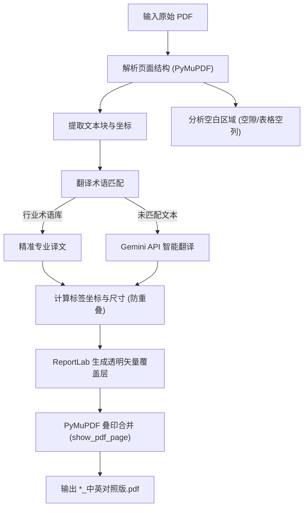

# PDF In-Place Bilingual Annotation Skill (中英文缝隙对照批注技能)

## 概述 (Overview)

本技能用于将外文技术资料（如服装工艺单 Tech Pack、尺寸规格表 Spec Sheet、工程图纸、说明书等）制作成**同页中英对照版**：
- **原文完全不调整**：原始英文排版、矢量线条、草图、尺寸标注 100% 保持不变。
- **填入空隙缝隙处**：中文译文以精致紧凑的半透明矢量标签形式，直接嵌入英文对应文字的下方或旁侧空白区域。
- **同页对照核对**：无需跨页翻阅，在同一张图纸或表格中同时呈现中英文，方便工厂师傅、跟单和质检快速核对。
- **100% 矢量无乱码**：使用 ReportLab 矢量透明层叠印技术，完美嵌入微软雅黑/黑体 TrueType 字体，彻底杜绝乱码与方块（``）。

---

## 核心工作流 (Standard Workflow)



---

## 步骤详解 (Step-by-Step Procedure)

### 步骤 1：解析 PDF 文本块与空白区域

使用 `pymupdf` (fitz) 提取页面上的所有文本块及其精确外接矩形：

```python
import fitz

doc = fitz.open("sample.pdf")
page = doc[0]
blocks = page.get_text("blocks")  # (x0, y0, x1, y1, text, block_no, block_type)
words = page.get_text("words")
```

### 步骤 2：术语翻译与分流处理

技术文档中的文本通常分为两类：
1. **规格尺寸表 (Spec Sheet / Measurement Table)**：
   - 特征：按字母序号（A~I）排布的部位名称（如 `1/2 CHEST WIDTH`、`BACK LENGTH` 等）。
   - 处理方式：在部位名称右侧与尺寸数据列左侧的空白列缝隙（如 `x ≈ 200~210`）处填入中文名称。
2. **图纸标注 (Callouts on Tech Drawings)**：
   - 特征：指向领口、门襟、挂耳、口袋、缝线的工艺说明。
   - 处理方式：优先放置在英文块正下方的空白处（`y = y1 + 1.5`）；若贴近页面底部，则放置在上方（`y = y0 - 13`）。
3. **通用度量过滤**：
   - 过滤纯数字/通用尺寸（如 `5CM`、`12CM`、`XS`、`2.2CM`），避免在无须翻译的尺寸线上产生杂乱标注。

### 步骤 3：标签视觉规范与防遮挡避让算法

为确保中文清晰可读且不破坏图纸美感，标签遵循以下核心规范：
- **字号标准（与英文等大）**：正文注释使用 **9.5 ~ 10.5 pt**，重要标题/款式名使用 **11.0 ~ 12.0 pt**（同英文原文字号相当，严禁使用小于 8pt 的微缩字，确保工厂车间和质检打印阅读清晰）。
- **文字样式**：深海军蓝（`#0038B8`，RGB: `0.0, 0.22, 0.72`）或企业深蓝（`#003366`），使用粗体（Bold），与图纸黑色/深灰英文形成明显反差。
- **背景框（Pill 标签）**：纯白底色，**92% 不透明度**（既能遮挡底图杂线，又能隐约透出底色），带细浅蓝边框与 2pt 圆角：
  ```python
  c.setFillColorRGB(1.0, 1.0, 1.0)
  c.setStrokeColorRGB(0.25, 0.48, 0.82)  # 浅钢蓝细边框
  c.setLineWidth(0.4)
  c.roundRect(rl_x, rl_y, pill_w, pill_h, 2, fill=1, stroke=1)
  ```
- **2D 智能避让与零碰撞检测机制**：
  1. 收集页面所有原始词块外接矩形 `page.get_text("words")`，外扩 1.8pt 建立禁入区域（Forbidden Rectangles）。
  2. 依序探测候选空隙位置：
     - 首选：英文正下方空隙 `y = y1 + 1.5`
     - 次选：英文正上方空隙 `y = y0 - pill_h - 1.5`
     - 三选：英文右侧空隙 `x = x1 + 4.0`
     - 四选：页面外围空白边栏
  3. 计算候选矩形与所有禁入矩形的交集，只有 **碰撞重叠数 = 0** 时才允许落笔；若单行过宽，自动折为两行渲染。
- **字体嵌入**：必须使用 Windows 本地 TrueType 字体（如 `msyhbd.ttc` 微软雅黑粗体或 `simhei.ttf` 黑体）。

### 步骤 4：ReportLab 坐标转换与透明层叠印

> [!IMPORTANT]
> **坐标系转换注意**：
> - PyMuPDF 原点 `(0, 0)` 在**页面左上角**（y 向下递增）。
> - ReportLab 原点 `(0, 0)` 在**页面左下角**（y 向上递增）。
> - 转换公式：`rl_y = page_height - y_from_top - pill_height`

```python
import io
from reportlab.pdfgen import canvas
from reportlab.pdfbase import pdfmetrics
from reportlab.pdfbase.ttfonts import TTFont

pdfmetrics.registerFont(TTFont("CN_FONT", r"C:\Windows\Fonts\msyhbd.ttc"))

buf = io.BytesIO()
c = canvas.Canvas(buf, pagesize=(page.rect.width, page.rect.height))

# 绘制标签...
c.save()

# 叠印透明层到原始 PDF 页面上
overlay_doc = fitz.open("pdf", buf.getvalue())
page.show_pdf_page(page.rect, overlay_doc, 0)
overlay_doc.close()
```

---

## 常用工具与辅助脚本

本技能内置了全自动化批处理脚本：
- 脚本位置：[scripts/annotate_pdf.py](./scripts/annotate_pdf.py)
- 服装与技术通用词典：[references/tech_terms.json](./references/tech_terms.json)

### 一键运行命令
```bash
python scripts/annotate_pdf.py --input "目标文件夹或PDF文件路径"
```

---

## 常见问题与避坑指南 (Troubleshooting)

1. **中文显示为方块或乱码 (``)**：
   - 原因：PyMuPDF 默认 `insert_text` 若未正确配置 CMap，中文字符会被截断为单字节 Latin 编码。
   - 解决方案：**必须使用 ReportLab 生成矢量透明层，再叠印回原页面**。
2. **模糊匹配导致的“误伤”短尺寸**：
   - 现象：`5CM`、`12CM` 被误翻译为某个包含该字符串的长短语。
   - 解决方案：只对长度大于等于 5 个字符的英文短语进行匹配，并且坚决不对纯数字/单位进行翻译。
3. **表格多行重叠在第一行**：
   - 原因：多行使用了相同前缀词（如 `1/2 CHEST WIDTH` 和 `1/2 WAIST WIDTH` 均以 `1/2` 开头）。
   - 解决方案：使用表格最左侧的独立行标字母（A、B、C...）的 Y 坐标作为基准定位行高。
